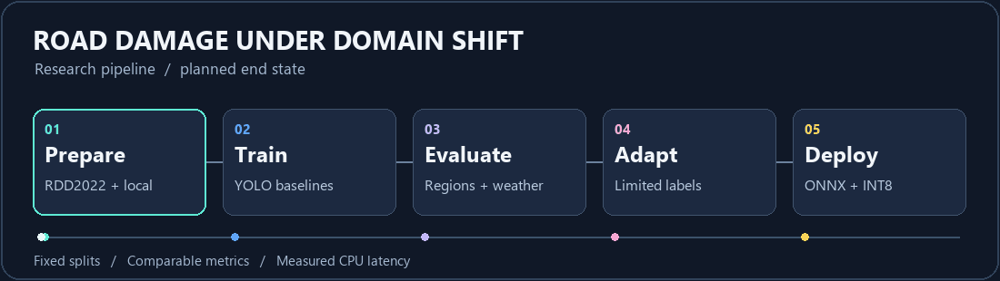
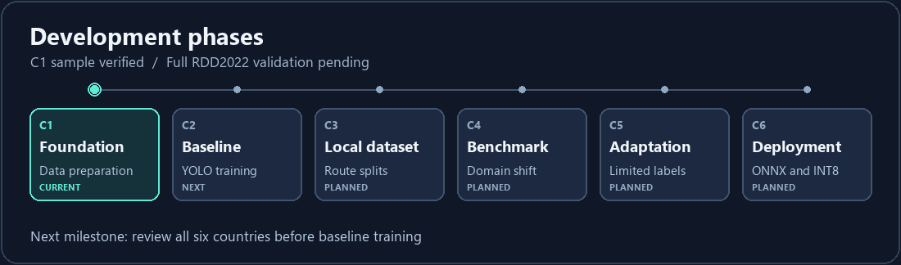

# Robust and Efficient Road Damage Detection Under Domain Shift



[Development status](#coding-roadmap) · [Run C1](#install-and-test) · [Research protocol](docs/experiment_plan.md) · [Static pipeline diagram](docs/assets/research-pipeline.png)

This project evaluates how road damage detectors hold up on unfamiliar roads, how much labeled data it takes to recover accuracy, and what the resulting models cost to run on a CPU.

**Current phase: C1 data preparation.** The pipeline passed tests on an official RDD2022 sample. Validation on the five selected RDD2022 countries is the next step, followed by C2 baseline training.

## What the completed project will deliver

| Deliverable | What it will show |
| --- | --- |
| Reproducible YOLO baselines | Dataset manifests, experiment configs, checkpoints, and detection metrics across seeds. |
| Bangladesh evaluation dataset | Local phone imagery with reviewed annotations, a data card, and route-based adaptation, validation, and test splits. |
| Domain shift benchmark | A train-country × test-country mAP matrix, condition tests for night, blur, and other corruptions, and a gallery of misses, false alarms, and localization errors. |
| Adaptation study | Compare stronger augmentation, few-shot fine-tuning, pseudo-labeling, and optional test-time adaptation under defined label and compute budgets. |
| CPU deployment benchmark | ONNX FP32 and INT8 models, accuracy and latency on fixed input sizes, and a video demo that draws detections and records timestamps. |

The benchmark will report mAP@0.5, mAP@0.5:0.95, and per-class AP for longitudinal cracks (D00), transverse cracks (D10), alligator cracks (D20), and potholes (D40). The deployment study will report median and 95th-percentile latency alongside accuracy. These are planned measurements.

## Coding roadmap



| Phase | Scope | Status |
| --- | --- | --- |
| C1 | Convert VOC annotations, create fixed splits, and audit the dataset | **Current** · sample verified, five-country validation pending |
| C2 | Train and evaluate config-driven YOLO baselines | **Next**, after C1 validation |
| C3 | Extract frames, review privacy, pre-label, and split Bangladesh data by route | Planned |
| C4 | Measure cross-region and cross-condition shifts and analyze errors | Planned |
| C5 | Compare adaptation methods at fixed label budgets | Planned |
| C6 | Export, quantize, benchmark on CPU, and release a demo | Planned |

## Install and test

Use Python 3.12. From this repository root, on Windows PowerShell:

```powershell
py -3.12 -m venv .venv
.\.venv\Scripts\python.exe -m pip install -r requirements.txt
.\.venv\Scripts\python.exe -m pytest -q
```

On Linux/macOS, use `python3.12 -m venv .venv` and replace the interpreter above with `.venv/bin/python`. Alternatively, use `conda env create -f environment.yml` from this directory. C1 runs on CPU and has no PyTorch, YOLO or tracking account requirement.

## Prepare RDD2022

The default benchmark uses Japan, India, Norway, the United States, and China (Drone and MotorBike). The Czech Republic is outside this benchmark. Bangladesh is the planned local target for C3 and will use separately collected and labeled images.

1. Obtain the [official Figshare v1 archive](https://doi.org/10.6084/m9.figshare.21431547.v1) (about 13.3 GB; MD5 `b62bd51d2ffcfaa76c60f234f0cc2bb3`). The outer ZIP contains country ZIPs; extract the six selected domain archives listed in the config. [Publisher download links and label definitions](https://github.com/sekilab/RoadDamageDetector#dataset) are also available. Allow disk space for both the extracted images and a processed copy. The dataset is [CC BY 4.0](https://api.figshare.com/v2/articles/21431547); cite Arya et al., [RDD2022](https://doi.org/10.1002/gdj3.260). The repository's code license does not cover the dataset.
2. Place the extracted directories under `data/raw/rdd2022`, keeping the original names and the paths `<domain>/train/images/` and `<domain>/train/annotations/xmls/`. An extra enclosing archive directory is fine. Official challenge test images are unlabeled and ignored.
3. Run preparation from the repository root:

```powershell
.\.venv\Scripts\python.exe -m rdd.data.prepare --config configs/data/rdd2022.yaml
```

For a Japan-only run, use `configs/data/rdd_japan.yaml`. Each run needs a fresh output directory. The CLI also exposes this command as `rdd-prepare` in an activated environment.

The output has one directory per country with `images/{train,val,test}`, matching `labels/{train,val,test}`, a YOLO `dataset.yaml`, and split text files relative to that country's directory. Rebuild or update the generated YAML's absolute `path` if you move the dataset. China pools Drone and MotorBike for the country split while retaining capture domains in the manifest and statistics.

- `manifest.csv`: source and output paths, SHA-256 hashes, split membership, class counts, skipped classes and clipped box counts.
- `stats.csv` and `dataset_stats.csv`: images, negatives, instances per class, image-size counts and relative box area buckets by capture domain and split. Add domain rows to get country counts for China.
- `run.json` and `experiments/logs/prepare-*.json`: effective config, seed, environment versions, counts, and hashes of the manifest and stats.

See the [data protocol and validation gate](docs/experiment_plan.md) for the conversion convention, leakage limits, and checks to perform before baseline training.

The [C1 verification record](docs/phase1_validation.md) documents the official sample used for the smoke test.

On Bash, run `bash scripts/run_data_pipeline.sh --config configs/data/rdd2022.yaml` from the repository root with the environment active. The dataset also includes image lists under `splits/<Country>/` with paths relative to the prepared dataset root and two PNG figures, `images_by_country.png` and `boxes_by_class.png`.

To check a converted annotation, copy a `source_image` value from the manifest and render it as a PNG. The following command uses the six-image China Drone sample and assumes its prepared directory exists.

```powershell
.\.venv\Scripts\python.exe -m rdd.data.preview data/processed/rdd2022_block_smoke China_Drone/train/images/China_Drone_000000.jpg data/block-preview.png
```
